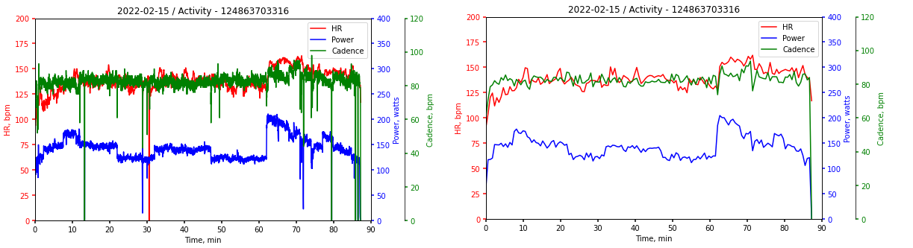
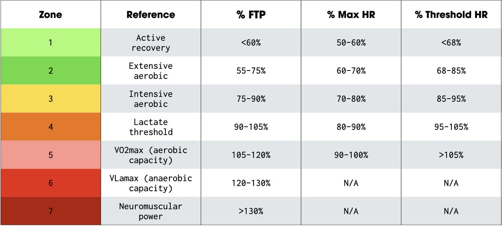
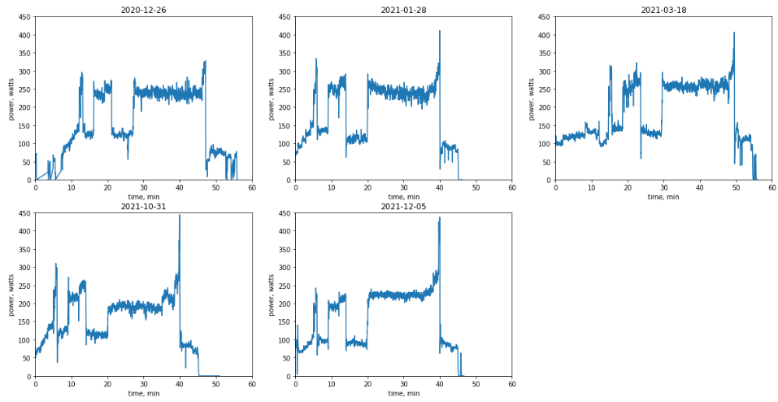

# 🚴 Анализ данных виртуальных велотренировок

> Глубокий анализ персональных данных о велотренировках из FIT-файлов с использованием Python и машинного обучения



## 📋 О проекте

Проект предназначен для детального анализа данных виртуальных велотренировок, полученных с устройств Garmin. В отличие от стандартных возможностей приложений Garmin Connect и Strava, этот инструментарий позволяет:

- 📊 Анализировать исторические данные всех тренировок
- 🎯 Классифицировать тренировки по зонам интенсивности
- 📈 Визуализировать показатели мощности, пульса и каденса
- 🤖 Автоматически определять типы тренировок с помощью машинного обучения
- 🔍 Сравнивать похожие тренировки между собой

## 🚀 Быстрый старт

### Требования
- Python 3.7+
- PostgreSQL
- FIT-файлы с тренировками (можно получить с [Garmin Connect](https://www.garmin.com/))

### Установка

1. Клонируйте репозиторий:
```bash
git clone https://github.com/QuestGuideRF/fit-ycling-analysis.git
cd fit-ycling-analysis
```

2. Установите зависимости:
```bash
pip install pandas psycopg2 matplotlib scipy numpy scikit-learn fitdecode
```

3. Настройте подключение к PostgreSQL в скриптах (замените параметры подключения на свои)

## 📁 Структура проекта

```
fit_ycling_analysis/
│
├── one_training_chart.py          # Визуализация одной тренировки
│   └── Построение графиков пульса, мощности и каденса
│       с применением сглаживания (сплайны)
│
├── training_zones.py              # Анализ зон интенсивности
│   └── Расчет распределения времени по 7 зонам мощности
│       и 3 зонам каденса для каждой тренировки
│
├── rf_classification.py           # Классификация тренировок
│   └── Применение алгоритма Random Forest для автоматического
│       определения типа тренировки (FTP, темпо, выносливость, восстановление)
│
├── similar_trainings_subplots.py  # Сравнение похожих тренировок
│   └── Визуализация профилей мощности для группы
│       похожих тренировок
│
├── seven_training_zones.jpeg      # Схема зон интенсивности
├── one_training_with_spline.png   # Пример графика тренировки
└── similar_3.png                  # Сравнение похожих тренировок
```

## 💡 Основные возможности

### 1️⃣ Визуализация тренировки

`one_training_chart.py` создает детальный график одной тренировки с тремя показателями:
- **Пульс (HR)** - красная линия
- **Мощность (Power)** - синяя линия
- **Каденс (Cadence)** - зеленая линия


### 2️⃣ Анализ зон интенсивности

`training_zones.py` рассчитывает распределение тренировочного времени по **7 зонам интенсивности**:



| Зона | % от FTP | Тип нагрузки |
|------|----------|--------------|
| 1 | ≤55% | Активное восстановление |
| 2 | 56-75% | Выносливость |
| 3 | 76-90% | Темп |
| 4 | 91-105% | Порог лактата |
| 5 | 106-120% | VO2 Max |
| 6 | 121-130% | Анаэробная мощность |
| 7 | >130% | Нейромышечная мощность |

### 3️⃣ Классификация тренировок

`rf_classification.py` использует **Random Forest** для автоматического определения типа тренировки:

- **Тип 0**: Восстановительная (легкая интенсивность, <1.5 часа)
- **Тип 1**: Выносливость (низкая интенсивность, >1.5 часа)
- **Тип 2**: Темпо (средняя интенсивность, 1.5-2 часа)
- **Тип 3**: FTP-тест (высокая интенсивность, <1 час)

### 4️⃣ Сравнение тренировок

`similar_trainings_subplots.py` создает сравнительные графики профилей мощности для похожих тренировок:



## 🔧 Как это работает

1. **Извлечение данных**: Парсинг FIT-файлов с помощью библиотеки `fitdecode`
2. **Хранение данных**: Загрузка в PostgreSQL (таблицы: Activity, Session, Record, Lap, File_Id)
3. **Обработка данных**: Расчет зон интенсивности на базе FTP (Functional Threshold Power)
4. **Анализ**: Статистический анализ и визуализация с помощью pandas и matplotlib
5. **Классификация**: Машинное обучение (Random Forest) для определения типов тренировок

## 📊 Ключевые метрики

Проект анализирует три основных показателя:
- **Мощность (Watts)** - работа, выполняемая на педалях
- **Каденс (RPM)** - частота педалирования
- **Пульс (BPM)** - частота сердечных сокращений

## 🎯 Для кого этот проект

- Любители велоспорта, желающие глубже анализировать свои тренировки
- Data scientists, интересующиеся анализом спортивных данных
- Тренеры, планирующие тренировочные программы

---

Автор: legenda  
Telegram: [@LEGENDA_SD](https://t.me/LEGENDA_SD)
